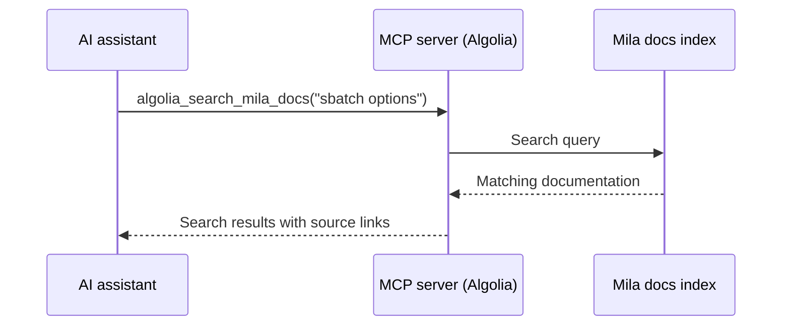

# Mila Docs MCP Server

**The Model Context Protocol (MCP)** is an open standard that lets AI assistants
connect to external knowledge sources as callable tools.

**The Mila documentation** is exposed through a public MCP server: registered in a
harness — OpenCode, Claude Code, Cursor, or any other MCP client — it gives
the assistant access to the full Mila documentation index. When a question
touches cluster commands, Slurm syntax, storage policies, or account setup,
the assistant can pull in accurate, up-to-date Mila guidance automatically,
without requiring a separate search.

## Before you begin

!!! note
    The Mila Docs MCP server is public and works with any MCP-capable harness —
    you can use one of this guide, but it is a recommendation, not a requirement.

<div class="grid cards" markdown>

-   [:material-run-fast:{ .lg .middle } __Get Started with the Mila Coding Agent__](../getting_started/mila_local_agent.md)
    { .card }

    ---
    Set up the recommended harness, OpenCode, against the Mila local agent.

-   [:material-robot:{ .lg .middle } __Set Up Claude Code__](claude_code.md)
    { .card }

    ---
    Install Claude Code and extend Claude Code with skills from a marketplace.

&nbsp;

</div>

## What this guide covers

* Understand what MCP is and how the Mila Docs MCP server works
* Register the Mila Docs MCP server in a harness
* See an example of the assistant using Mila context to answer a question

---

## What is MCP?

MCP (Model Context Protocol) is an open standard that defines how AI tools
communicate with external services. An MCP **server** exposes one or more
tools — actions the AI can invoke, such as searching a database or fetching
a web page. The harness running the model (OpenCode, Claude Code, Cursor)
acts as the MCP **client**: it discovers the available tools on startup,
then calls them automatically when a query requires external data.



## The Mila Docs MCP server

The Mila documentation site is indexed by
[DocSearch](https://docsearch.algolia.com/) made by Algolia and exposes a public
MCP server at the following endpoint:

```
https://558773LESW.algolia.net/mcp/1/3_N8rKyLQhaxUEpt0FMx6A/mcp
```

The server exposes a search tool that accepts natural-language queries and
returns matching sections of the Mila documentation. The Search API key is
embedded in the URL — no additional authentication is required.

## Configure a harness

Registering the server means adding one entry to the configuration of the
harness. Every MCP client needs the same information:

* a name for the server — `mila-docs` is the conventional choice;
* the endpoint URL of the server;
* the transport — HTTP, called `remote` in OpenCode.

Then launch the harness, or restart it if it was already running, so the
registered server is discovered.

=== "OpenCode (recommended)"

    !!! tip
        The configuration from
        [Get Started with the Mila Coding Agent](../getting_started/mila_local_agent.md)
        already registers this server — skip this tab if that guide was
        followed.

    Add the `mcp` block to the global configuration
    (`~/.config/opencode/opencode.jsonc`, applied to every project) or to a
    project-level `opencode.jsonc`:

    ```jsonc title="~/.config/opencode/opencode.jsonc"
    {
      "mcp": {
        "servers": {
          "mila-docs": {
            "type": "remote",
            "url": "https://558773LESW.algolia.net/mcp/1/3_N8rKyLQhaxUEpt0FMx6A/mcp"
          }
        }
      }
    }
    ```

    Launch OpenCode and confirm that `mila-docs` appears among the active
    MCP servers:

    ```bash
    opencode
    ```

    ??? info "CLI alternative"
        OpenCode can also write the entry itself. Without `--global`, the
        server is added to the project configuration:

        ```bash
        opencode mcp add mila-docs --global \
            --url https://558773LESW.algolia.net/mcp/1/3_N8rKyLQhaxUEpt0FMx6A/mcp
        ```

=== "Claude Code"

    Run the following command to register the Mila Docs MCP server:

    ```bash
    claude mcp add --transport http mila-docs \
        https://558773LESW.algolia.net/mcp/1/3_N8rKyLQhaxUEpt0FMx6A/mcp
    ```
    <div class="result" style="border:None; padding:0" markdown>
    ``` linenums="0"
    Added HTTP MCP server mila-docs with URL: https://558773LESW.algolia.net/mcp/1/3_N8rKyLQhaxUEpt0FMx6A/mcp to local config
    File modified: /Users/username/.claude.json [project: /Users/username/CODE/mila-docs]
    ```
    </div>

    By default, the server is registered with the `local` scope: it is
    available only in the current project, and only to the current user.
    Run `claude mcp list` (or `/mcp` inside a session) to confirm that
    `mila-docs` is connected.

    !!! tip "Choose the scope"
        * Add `--scope user` to make the server available in every project.
        * Add `--scope project` to write it to `.mcp.json` at the project
          root, so that everyone working on the repository shares it.

    ??? info "Config file"
        Alternatively, add the server entry to `~/.claude.json` (user scope)
        or `.mcp.json` at the project root (project scope), then restart
        Claude Code:

        ```json
        {
          "mcpServers": {
            "mila-docs": {
              "type": "http",
              "url": "https://558773LESW.algolia.net/mcp/1/3_N8rKyLQhaxUEpt0FMx6A/mcp"
            }
          }
        }
        ```

=== "Cursor"

    Cursor reads MCP configuration from a JSON file. Create or edit the file
    at one of the following paths:

    | Scope | File |
    |-------|------|
    | Global (all projects) | `~/.cursor/mcp.json` |
    | Project only | `.cursor/mcp.json` (project root) |

    Add the following entry:

    ```json
    {
      "mcpServers": {
        "mila-docs": {
          "url": "https://558773LESW.algolia.net/mcp/1/3_N8rKyLQhaxUEpt0FMx6A/mcp"
        }
      }
    }
    ```

    After saving, open **Cursor Settings → MCP** and confirm that `mila-docs`
    shows a green status indicator.

??? tip "Any other MCP-capable harness"
    Harnesses that support remote MCP servers all follow the same pattern:
    give the server a name, set the endpoint URL, and select the HTTP
    transport. See the documentation of the harness for the exact syntax.

## Ask the assistant about Mila

Once the MCP server is configured, the AI assistant can answer questions about
Mila systems accurately — drawing on the documentation automatically as part of
the normal conversation flow.

**Example — asking about Slurm job cancellation:**

```
How do I cancel a running Slurm job on the Mila cluster?
```

<div class="result" style="border:None; padding:0" markdown>
``` linenums="0"
Use scancel with the job ID:

  # Cancel a specific job

  scancel <JOBID>

  # Cancel all jobs of the account (running and pending)

  scancel -u USERNAME

  # Cancel only the pending jobs

  scancel -t PD

To find the job ID first, run squeue --me. More details in the https://docs.mila.quebec/help/faq/#how-do-i-cancel-a-job.

```
</div>

!!! tip
    Phrase queries naturally — no special syntax is required. The assistant
    selects the search tool and constructs the query automatically.

---

## Key concepts

**MCP (Model Context Protocol)**
:   Open standard that defines how AI tools communicate with external services
    using a client/server model.

**MCP server**
:   A service that exposes tools an AI assistant can invoke. The Mila Docs MCP
    server exposes Algolia search over the Mila documentation index.

**MCP client**
:   The AI harness (OpenCode, Claude Code, Cursor) that connects to MCP
    servers, discovers their tools, and calls them automatically.

## Next steps

<div class="grid cards" markdown>

-   [:material-toy-brick:{ .lg .middle } __Add Mila Skills__](mila_skills.md)
    { .card }

    ---
    Add the Mila skills marketplace and install cluster-focused skills.

-   [:material-book:{ .lg .middle } __Add Mila Docs context to AI assistants__](context.md)
    { .card }

    ---
    Provide a condensed Markdown reference to any LLM chat assistant.

</div>
