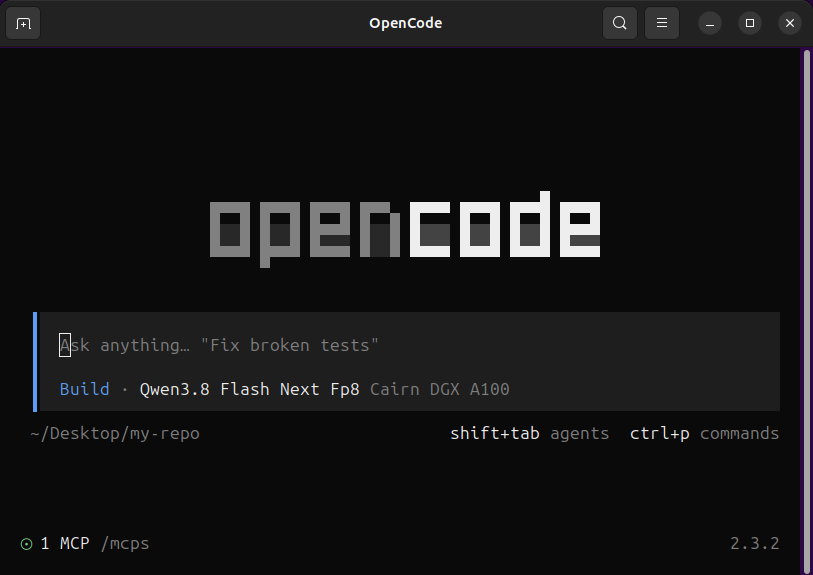

# Get Started with the Mila Coding Agent

<nav class="progress-track" aria-label="Getting started progression">
    <div class="progress-step is-done">
        <div class="progress-marker"><a href="../cluster_access">✓</a></div>
        <div class="progress-label"><a href="../cluster_access">Enable your cluster access</a></div>
    </div>
    <div class="progress-step is-done">
        <div class="progress-marker"><a href="../mfa">✓</a></div>
        <div class="progress-label"><a href="../mfa">Set up MFA</a></div>
    </div>
    <div class="progress-step is-done">
        <div class="progress-marker"><a href="../connect_to_the_cluster">✓</a></div>
        <div class="progress-label"><a href="../connect_to_the_cluster">Connect to the cluster</a></div>
    </div>
    <div class="progress-step is-done">
        <div class="progress-marker"><a href="../my_first_job">✓</a></div>
        <div class="progress-label"><a href="../my_first_job">Run your first job</a></div>
    </div>
    <div class="progress-step is-done">
        <div class="progress-marker" aria-current="step"><a href="../train_first_model">5</a></div>
        <div class="progress-label"><a href="../train_first_model">Train your first model</a></div>
    </div>
    <div class="progress-step is-current">
        <div class="progress-marker"><a href="../mila_local_agent">6</a></div>
        <div class="progress-label"><a href="../mila_local_agent">Use Mila local agent</a></div>
    </div>
</nav>

Mila provides a **locally hosted** AI agent stack running on a DGX-A100 node of the
Mila cluster. It serves open-weight language models behind a LiteLLM gateway
that exposes an OpenAI-compatible API, so any agent harness that supports
such an endpoint can use the agent instead of a cloud
provider. We recommend the agent harness OpenCode in this guide, feel free to use another one.

!!! warning "Beta"
    The Mila agent is in beta. Announcements are posted on the `#mila-local-agent` Slack channel, but this is a community channel.
    Feel free to reach out there or to the IDT team if you encounter issues or have ideas.

!!! success "Requirements"
    - `sudo` privileges on your machine.

## What this guide covers

* Overview of the Mila agent
* Get and store an API key
* Route traffic to the agent node from a local machine
* Test the connection with a direct API call
* Configure OpenCode

---

## Overview of the Mila agent

**Why use it?**

!!! success "A locally hosted coding agent"

    * Data do not leave the Mila ecosystem
    * It runs on our own resources
    * Free for Mila researchers
    * You can be part of it by your feedback

**What's in there?**

<div class="wf2-table-wrap">
  <table class="wf2-table">
    <tbody>
      <tr>
        <th scope="row">Model</th>
        <td>Qwen3.8-Flash-Next-fp8</td>
      </tr>
      <tr>
        <th scope="row">Node</th>
        <td>8 x DGX-A100 (Node <code>cn-d003.server.mila.quebec<code>)</td>
      </tr>
    </tbody>
  </table>
</div>

## Get an API key

1. Get an API key by asking IDT team for one, by mail, Slack or during the [Office Hours](../help/office_hours.md).

2. Store it by adding the export to `~/.bashrc`:

    ```bash
    export MILA_AGENT_KEY=sk-…
    ```

3. Then reload the shell configuration:

    ```bash
    source ~/.bashrc
    ```

## Route traffic to the agent node from a local machine

??? info "How it works"

    The Mila agent stack listens on port `8080` at `cn-d003.server.mila.quebec`.
    The node is not directly accessible from the Mila wifi yet, so traffic must
    be routed through a Mila login node:

    ```mermaid
    graph LR
        A[Local machine] -->|"ssh mila -L 8080:...:8080"| B[Login node]
        B -->|forwards port 8080| C[cn-d003:8080]
    ```

    Once the route is active, the stack is reachable at
    `http://cn-d003.server.mila.quebec:8080` from the local machine.
    OpenCode and other harnesses address the gateway by hostname, so the local
    machine must resolve `cn-d003.server.mila.quebec` to itself and forward the port through the login node.

1. Start a SSH tunnel with port forwarding:

    ```bash
    ssh mila -L 8080:cn-d003.server.mila.quebec:8080  # (1)!
    ```

    1. `-L 8080:cn-d003.server.mila.quebec:8080` forwards local port 8080 to
        port 8080 on the node, through the login node. Keep this session
        open while working with the Mila agent.

2. Then add this line to `/etc/hosts` (editing `/etc/hosts` requires `sudo`):

    ``` linenums="0"
    127.0.0.1   cn-d003.server.mila.quebec
    ```

## Test the connection

Send a direct request to the chat completions endpoint. The same command
works from the local machine (with the SSH tunnel active) and from any
login node or compute node on the cluster:

```bash
curl "http://cn-d003.server.mila.quebec:8080/v1/chat/completions" \
  -H "Authorization: Bearer $MILA_AGENT_KEY" \
  -H "Content-Type: application/json" \
  -d '{"model":"Qwen/Qwen3.8-Flash-Next-FP8","messages":[{"role":"user","content":"Reply with OK."}],"max_tokens":16}'
```

A successful call returns a JSON object whose message content echoes the
prompt:

```json linenums="0"
{"choices":[{"message":{"content":"OK","role":"assistant"}}]}
```

!!! warning "Plain HTTP, not HTTPS"
    The connection between the login node and the agent node currently uses
    plain HTTP. In theory, someone on the cluster with network interface
    access or `sudo` could capture the LiteLLM, Grafana, or API keys — not
    the `@mila.quebec` account credentials. These cases are extreme, but
    keep them in mind until HTTPS is set up.

## Configure OpenCode

!!! tip "Endpoint for the harness"

    To use the agent with another harness, point the latter to the OpenAI-compatible endpoint:

    ```
    http://cn-d003.server.mila.quebec:8080/v1/
    ```

1. Install OpenCode from <https://opencode.ai/>. Then create the configuration
file at `~/.config/opencode/opencode.jsonc`:

    ```jsonc title="~/.config/opencode/opencode.jsonc"
    {
    "$schema": "https://opencode.ai/config.json",

    // Basic suggested Guardrails: never let the agent fetch .cn domains (last matching rule wins,
    // so the specific denies must come after the broad ask rules).
    "permissions": [
        { "action": "shell", "resource": "curl *", "effect": "ask" },
        { "action": "shell", "resource": "wget *", "effect": "ask" },
        { "action": "shell", "resource": "curl *://*.cn*", "effect": "deny" },
        { "action": "shell", "resource": "curl *.cn*", "effect": "deny" },
        { "action": "shell", "resource": "wget *://*.cn*", "effect": "deny" },
        { "action": "shell", "resource": "wget *.cn*", "effect": "deny" },
        { "action": "shell", "resource": "* curl *://*.cn*", "effect": "deny" },
        { "action": "shell", "resource": "* wget *://*.cn*", "effect": "deny" },
        { "action": "webfetch", "resource": "*.cn", "effect": "deny" },
        { "action": "webfetch", "resource": "*.cn/*", "effect": "deny" },
        { "action": "webfetch", "resource": "*.cn:*", "effect": "deny" }
    ],

    // Hard layer: evaluated after permissions and saved "Allow always"
    // approvals, so no approval or agent rule can lift these.
    "policies": [
        { "action": "tool.use", "resource": "shell:*://*.cn*", "effect": "deny" },
        { "action": "tool.use", "resource": "shell:*curl *.cn*", "effect": "deny" },
        { "action": "tool.use", "resource": "shell:*wget *.cn*", "effect": "deny" },
        { "action": "tool.use", "resource": "webfetch:*://*.cn", "effect": "deny" },
        { "action": "tool.use", "resource": "webfetch:*://*.cn/*", "effect": "deny" },
        { "action": "tool.use", "resource": "webfetch:*://*.cn:*", "effect": "deny" }
    ],

    "plugin": [
        "opencode-models-discovery@latest"
    ],
    "skills": [
      "https://mila-iqia.github.io/skills/opt-tools/skills",
      "https://mila-iqia.github.io/skills/mila-tools/skills"
    ],
    "mcp": {
        "servers": {
            "mila-docs": {
                "type": "remote",
                "url": "https://558773LESW.algolia.net/mcp/1/3_N8rKyLQhaxUEpt0FMx6A/mcp",
                "enabled": true
            }
        }
    },
    "provider": {
        "a100": {
        "npm": "@ai-sdk/openai-compatible",
        "name": "DGX A100",
        "options": {
            "baseURL": "http://cn-d003.server.mila.quebec:8080/v1",
            "apiKey": "{env:MILA_AGENT_KEY}",
            "modelsDiscovery": {
            "enabled": true,
            "smartModelName": true,
            "modelInfoFormat": "litellm"
            }
        }
        }
    }
    }
    ```

    ??? info "Configuration explanation"
        * The **skills** part loads the Mila Skills, available in [this Github repository](https://github.com/mila-iqia/skills).
        * The **mcp** refers to the MCP of the [Mila cluster documentation](https://docs.mila.quebec/).
        * The **`a100` provider** speaks the OpenAI-compatible protocol to the
        gateway.
            * `baseURL` is the agent node URL
            * `apiKey` reads the `MILA_AGENT_KEY` environment variable at runtime, so no
        key is stored in the file.
            * The `opencode-models-discovery` plugin lists the models available on the
        gateway automatically, so newly deployed models appear in OpenCode without
        a configuration change.

2. Launch OpenCode

    ```bash
    opencode
    ```

    Here you are! You can check:

    * **The model** is `Qwen3.8 Flash Next Fp8`.
    * **Your repository** is the repository where you want to work (`~/Desktop/my-repo` on the screenshot).
    * **One MCP** is active (the Mila docs one, as described in the configuration).

    

---

## Key concepts

Model discovery
:   Querying the gateway's model list at runtime so the harness shows the
    currently deployed models without manual configuration.
